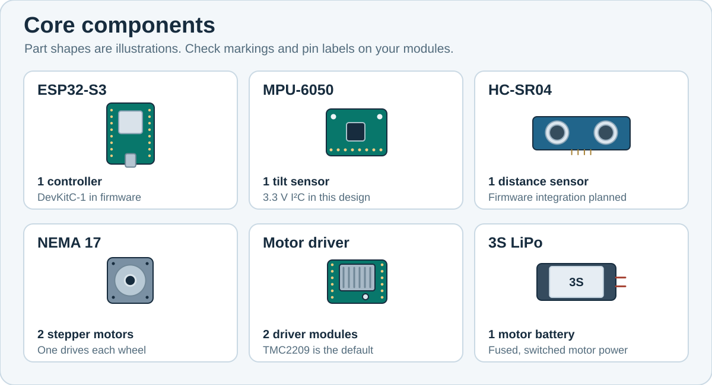
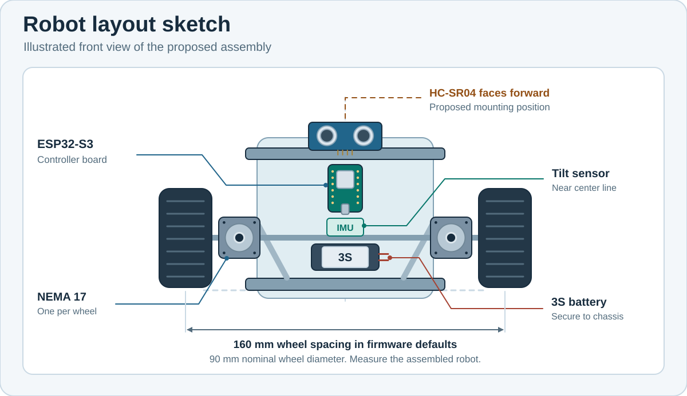
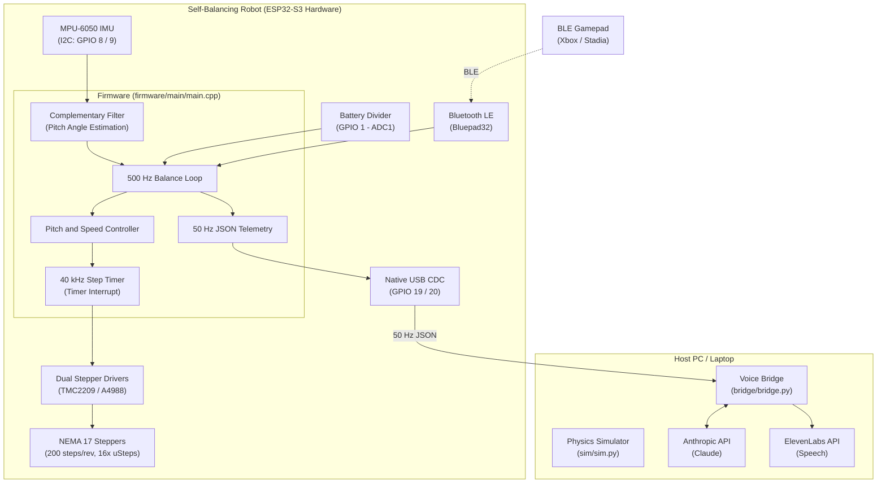
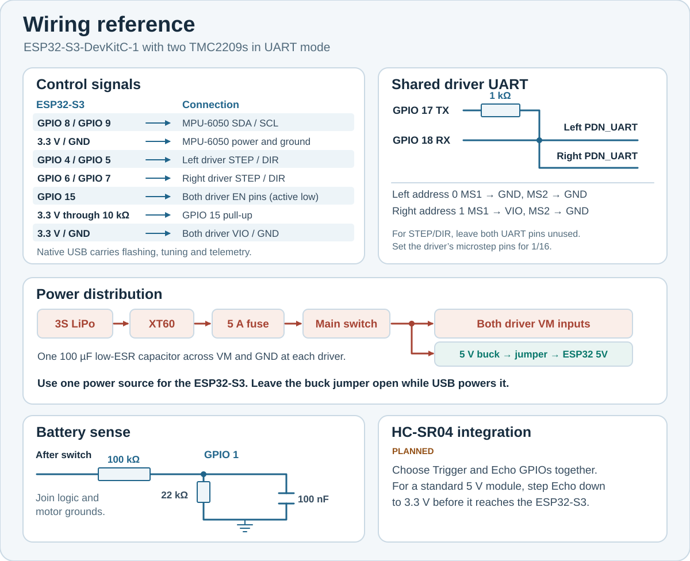
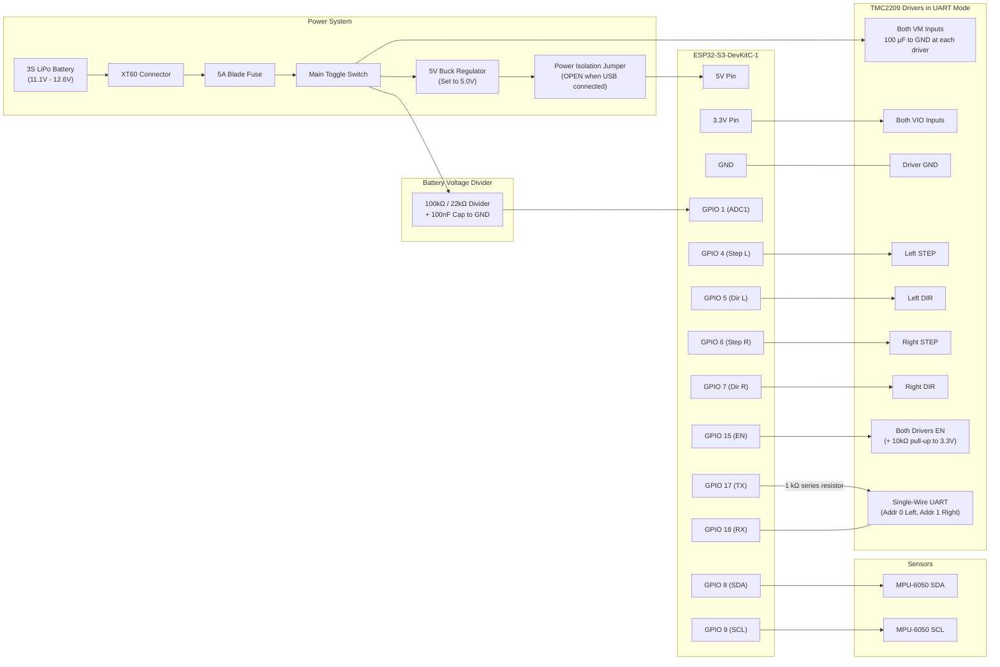
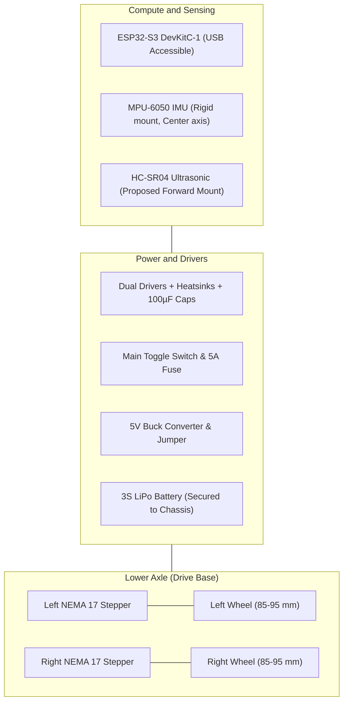
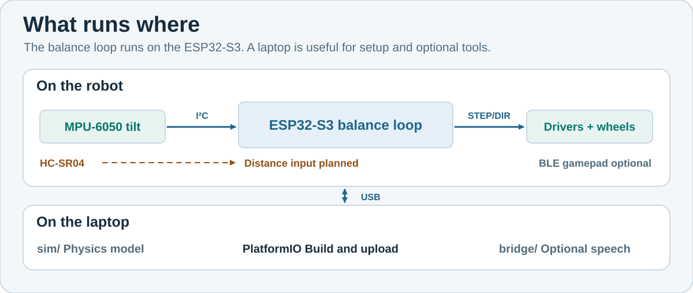
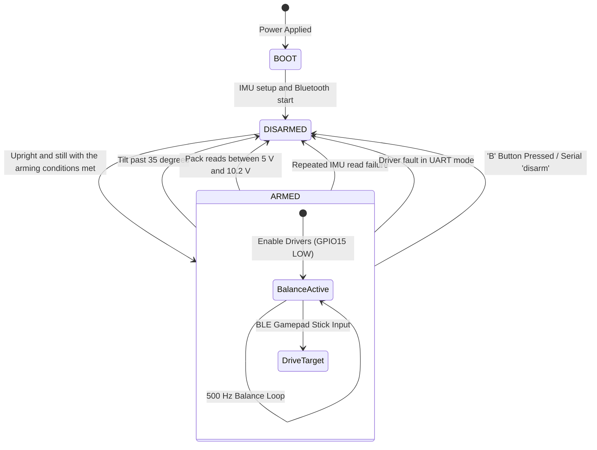

# Balance bot (IEEE at UCSD QP, Project 28)

A two-wheeled robot designed to balance on two NEMA 17 steppers. The ESP32-S3
runs the balance loop at 500 Hz. A Bluetooth gamepad can control movement, and
an optional Python bridge on a laptop turns telemetry into speech. The team
chose the HC-SR04 for obstacle detection. Its wiring and firmware are pending.

| Folder | What it is | Status |
|---|---|---|
| `sim/` | Plain-Python physics model for picking gains before hardware | Runs; default gains recover and drive in every scenario |
| `firmware/` | PlatformIO project for the ESP32-S3 with Arduino-ESP32 3.3.12, ESP-IDF 5.5.5 and Bluepad32 | Both targets built during review with the Windows workarounds below. Robot and gamepad tests are pending. |
| `bridge/` | Serial telemetry to Claude, ElevenLabs and the laptop speaker | Six tests pass. Live speech testing is pending. |

## Hardware at a glance



The ESP32-S3 and HC-SR04 are confirmed choices. The other parts shown come
from the current design. Driver modules and breakout boards can have different
pin labels, so check the markings on the parts your team has.



The assembly sketch shows the proposed layout. The 90 mm wheel diameter and
160 mm wheel spacing come from [the firmware defaults](firmware/include/config.h).
Measure both on the assembled robot before tuning. The enclosure and sensor
mount are still open.

<details>
<summary>Detailed control and telemetry diagram</summary>



</details>

## 1. Simulate (no hardware)

```bash
cd sim
python sim.py            # recovery from tilts and shoves, plus driving with the gamepad limits
python sim.py --sweep    # which kp/kd pairs survive every scenario
python sim.py --L 0.15 --M 1.3   # your robot: centre-of-mass height above the axle (m) and body mass (kg)
```

The sim feeds the controller a simulated accelerometer and gyro through the same
complementary filter as the firmware. Its `torque` column is the peak torque each
motor must deliver; check it against your motor's pull-out torque at that speed.
Measure `L` on the printed chassis (balance it on a ruler edge) and re-run.

Driving: the stick asks for a speed, the firmware ramps the speed target with limited
acceleration and jerk, and the robot leans into that acceleration (`kff`). Without that lean
the sim lags the stick by about 0.25 m/s; with it, under 0.07 m/s, and the lean peaks near 5
degrees at the default 0.4 m/s. The sim models only the speed shaper and lean, not turning; to
check a change to `DRIVE_*` in `config.h`, copy it into `Drive` and `DRIVE_SPEED` in `sim.py`.

## 2. Wiring (ESP32-S3-DevKitC-1)



This diagram shows signal names and power connections. Check their positions on
the [ESP32-S3-DevKitC-1 pinout](https://docs.espressif.com/projects/esp-idf/en/v5.3/esp32s3/hw-reference/esp32s3/user-guide-devkitc-1.html)
and on the specific driver modules you have. The wiring has been checked against
the firmware pin assignments and component documentation. Bench verification is pending.

| Signal | GPIO | Goes to |
|---|---|---|
| I2C SDA / SCL | 8 / 9 | MPU-6050 SDA / SCL (3.3 V) |
| Left STEP / DIR | 4 / 5 | Left TMC2209 STEP / DIR |
| Right STEP / DIR | 6 / 7 | Right TMC2209 STEP / DIR |
| Motor EN (active low) | 15 | EN of both drivers, plus a 10 kOhm pull-up to 3.3 V |
| TMC UART TX | 17 | Through 1 kΩ to the shared PDN_UART line |
| TMC UART RX | 18 | Directly to the shared PDN_UART line on both drivers |
| Battery sense | 1 | Switched pack + (after the main switch) -> 100 kOhm -> GPIO1 -> 22 kOhm -> GND, 100 nF to GND |
| USB (native port) | 19 / 20 | Laptop: telemetry, tuning, flashing |

<details>
<summary>Detailed power and signal map</summary>



</details>

The two TMC2209s share one UART line. Put the resistor on TX so either driver
can send its reply back to RX. See Figure 4.1 in the
[TMC2209 datasheet](https://www.analog.com/media/en/technical-documentation/data-sheets/tmc2209_datasheet_rev1.08.pdf).
Connect both drivers' VIO to 3.3 V and join all grounds. Set both MS pins low
on the left driver for address 0. On the right driver, set MS1 to VIO and MS2
to ground for address 1. Keep the VREF pots low because the drivers revert to
their pin settings and pot current after a power loss. The firmware checks UART
mode and tries to reapply the settings after a reset. Set the SPREAD jumper low
(BTT "mute" default). The firmware selects SpreadCycle over UART.

Put a 100 µF low-ESR capacitor across VM and GND at each driver, with the main
switch between the pack and both capacitors. Fit a heatsink to each driver.

Power: 3S LiPo -> XT60 -> 5 A blade fuse -> switch -> drivers' VM, and a 5 V buck
(an LM2596 module set to 5.0 V with a meter before you connect it, or a Pololu D36V28F5) -> a jumper -> ESP32-S3 5V pin. No Raspberry Pi on the
robot in the first build; the laptop is the host.

**Use one power source for the ESP32-S3.** While USB powers the logic, leave the
buck jumper open. The pack still powers the motors and the grounds stay joined.
Close the jumper for untethered operation or when using a USB cable with VBUS cut.

### HC-SR04 obstacle detection (planned)

Choose the Trigger and Echo GPIOs and record them in `firmware/include/config.h`
when adding the firmware. For a [standard 5 V HC-SR04](https://www.digikey.com/htmldatasheets/production/3822706/0/0/1/hc-sr04.pdf),
use a voltage divider or level shifter on Echo before it reaches the ESP32-S3.
Verify the sensor variant first. Measure distance without waiting for an echo in
the 500 Hz balance loop.

### Free drivers instead of TMC2209s

If the drivers you can borrow (EnVision, the IEEE Project Space) are A4988s, DRV8825s, or TMC2208s
without UART, build the STEP/DIR version: `pio run -e esp32s3_stepdir -t upload`. Wire STEP, DIR and
EN as in the table, leave GPIO17/18 unconnected, and set each driver by hand:

| Driver | 1/16 microstep (`MICROSTEPS 16`) | Current |
|---|---|---|
| A4988 | MS1, MS2, MS3 all HIGH | Set Vref with the pot: I = Vref / (8 x Rsense), Rsense usually 0.1 Ohm (check the module) |
| DRV8825 | M0 LOW, M1 LOW, M2 HIGH | I = Vref / (5 × Rsense), or 2 × Vref on a 0.1 Ω carrier |
| TMC2208 / TMC2209 standalone | MS1 and MS2 both HIGH (both low is 1/8) | Vref per the module's sheet |

Start at about 0.6 A and raise it only if a wheel skips steps. Keep the 100 µF
cap at each driver. Hold RESET and SLEEP high on A4988 and DRV8825 modules as
specified by the carrier manufacturer. For example, both pins need a logic high
on the [Pololu DRV8825 carrier](https://www.pololu.com/product/2133#details).
Check that both drivers have power before arming. If the microstep pins select
a setting other than 1/16, change `MICROSTEPS` in `config.h` to match.

<details>
<summary>Component mounting checklist</summary>



</details>

## 3. Flash and bring up

### Files you need



Clone the repository and build from the **full [`firmware/`](firmware/) folder**.
It is a complete PlatformIO project with these parts.

| Files | Purpose |
|---|---|
| [`main/`](firmware/main/) | `app_main.c` starts the board, `main.cpp` reads the tilt sensor and drives both motors, and `gamepad.cpp` reads the Bluetooth controller. |
| [`include/`](firmware/include/) | `config.h` contains the GPIO assignments and tuning defaults. `pad.h` connects the gamepad code to the balance code. |
| [`platformio.ini`](firmware/platformio.ini), the `CMakeLists.txt` files, [`sdkconfig.defaults`](firmware/sdkconfig.defaults), and [`dependencies.lock`](firmware/dependencies.lock) | Set the board, build options and dependency versions. |
| [`components/`](firmware/components/) and [`third_party/`](firmware/third_party/) | Bundled code for Bluetooth and related dependencies. |

`sim/` and `bridge/` run on a laptop. The bridge is optional and the ESP32-S3
balances without it. Flashing the board does not require speech API keys.

### Build and upload

From the `firmware/` folder, choose the target that matches your motor drivers.

| Driver wiring | Build | Upload |
|---|---|---|
| TMC2209 with UART | `pio run -e esp32s3` | `pio run -e esp32s3 -t upload` |
| A4988, DRV8825 or standalone TMC2208/2209 | `pio run -e esp32s3_stepdir` | `pio run -e esp32s3_stepdir -t upload` |

PlatformIO uploads the bootloader, partition table and program image to the
right locations. The build writes these files and a combined
`firmware.factory.bin` under `.pio/build/<target>/`. Use the target that matches
your drivers. Open the serial monitor after uploading to see telemetry.

```sh
pio device monitor
```

On Windows, use PowerShell or cmd and keep the checkout and PlatformIO core paths
short. The first build downloads dependencies and compiles the Arduino core.
The pinned ESP32 platform rejects `pioarduino` `6.2.0.post1`. The review build
used `6.2.0` and ran the linker-script generator directly to work around the
Windows command-length limit. See the
[upstream version issue](https://github.com/pioarduino/platform-espressif32/issues/563)
for the version pin workaround.

The native USB port (the one you flash through) carries only the JSON telemetry and commands.
ESP-IDF and Bluetooth logs, and crash backtraces, go to the board's other USB connector
(marked UART) at 115200 baud. Plug both in when something crashes.

`firmware/sdkconfig.defaults` sets the ESP-IDF options. If you change it, delete
`firmware/sdkconfig.esp32s3` so the next build picks the change up.

<details>
<summary>Arming and shutdown transitions</summary>



</details>

### First bench test

Bring-up order, wheels off the ground (robot on a stand) until step 5:

1. Battery off, USB on. The monitor shows telemetry, or an `error`/`warn` line naming what is missing.
2. Tilt the robot forward by hand: `p` must go positive and `r` must be positive while it moves.
   If not, change `ACCEL_FWD`, `ACCEL_UP`, `GYRO_PITCH` or `GYRO_SIGN` in `include/config.h`.
   Mount the IMU on the body's centre line; its height does not need to match anything.
3. Hold it at its balance point (where it stays put when you let go of it on a stand) and type
   `trim <p>`, using the `p` it reads there. `p` then reads 0 at that point. Trims replace each other,
   so to adjust later type `trim <old trim + new p>`.
4. Battery on. The warning about a TMC2209 not answering must not appear.
5. Wheels still off the ground, hold it upright and still: it arms after 0.5 s (`{"ev":"armed"}`).
   Tip it forward a little: both wheels must spin the way that would drive the robot toward the
   lean. If one spins the wrong way, flip `RIGHT_MOTOR_REVERSED` (or swap that motor's coil pair
   with the battery off); if both do, flip both DIR senses. Verify the stop command,
   motor-power loss and IMU-dropout handling on the stand before a floor test.
   Beyond 35 degrees it cuts the motors (`{"ev":"fell"}`); lift it upright to re-arm.

## 4. Tune (type into the serial monitor)

`kp 40` `kd 3` `kv 0.1` `ki 0.05` `kff 1` `trim -1.5` `arm` `disarm` `pair` `forget` `get`

`disarm` keeps the motors off until `arm` (or A on the pad), even if you hold the robot upright.
`pair` looks for a new pad for 20 s and `forget` unpairs every pad; both only work while disarmed.
An `arm` (or A) that cannot arm right then is dropped, not saved for later.

1. `kv 0` and `ki 0`. Raise `kp` until it catches itself and starts to oscillate, then raise `kd` until the oscillation dies.
2. Bring back a small `kv`, then `ki`, until it stops drifting across the floor.
3. To slow down it must first lean back, so the speed loop's effect looks backwards. That is expected.
4. Watch `loop_us` and `jit_us`. If the loop is late often or `jit_us` stays above about 20 us, set
   `CONTROL_HZ 250` in `config.h`: working stepper balancers run at 100-250 Hz, and the simulator's
   default gains still recover at 250 Hz.

Write the final gains back into `config.h`.

## 5. Drive with a gamepad

Bluepad32 pairs one Bluetooth LE gamepad. The S3 has no Bluetooth Classic, so PS4, PS5, Switch
and Wii pads will not connect. An Xbox Wireless controller works once its firmware is 5.x or
newer (update it in the Xbox Accessories app on a PC or Xbox). Steam and Stadia pads need their
Bluetooth firmware update.

1. Power the board and leave the robot lying down. For 20 s after boot (and after `pair`, `forget`,
   or losing the pad) it looks for pads, and it will not arm until 3 s after that window closes,
   because pairing writes to flash and that pauses the balance loop. A pad that connects closes the
   window early. Without a pad, the robot can first arm about 23 s after boot.
2. Hold the pad's pair button until its logo flashes fast. The monitor prints
   `{"ev":"pad_connected"}`, and telemetry shows `pad_ms` (age of the last report) instead of -1.
3. Arm as usual (hold it upright and still), or press A. The stick must be centred to arm.
4. Left stick up and down asks for speed, up to `DRIVE_SPEED_MAX_MPS` (0.4 m/s). Left and right turns.
5. B is the stop button: motors off at once, and they stay off until A or `arm`.

If the pad goes quiet for 0.3 s or disconnects, the targets fall back to zero and the robot keeps
balancing in place (`{"ev":"pad_lost"}` on a disconnect). A pad lost while armed cannot reconnect
until the robot is disarmed (tip it past 35 degrees, or type `disarm`), so B is gone until then. Telemetry adds `vt` (speed target, m/s)
and `yaw` (turn rate target, rad/s). To check directions with the wheels off the ground, watch telemetry
rather than the wheels (the balance loop fights you on a stand: to drive forward it first spins the
wheels backward to lean forward). Stick up must make `vt` go positive, and stick right must make
`yaw` positive and the left wheel spin faster than the right. If pushing the stick
still stops the robot after 0.3 s, watch `pad_ms` while holding the stick still; if it climbs past
300, raise `GAMEPAD_TIMEOUT_MS`. Measure `TRACK_WIDTH_M` (wheel centre to wheel centre).

## 6. Voice bridge

```bash
cd bridge
uv sync
uv run pytest -q
uv run python bridge.py --fake --no-voice        # synthetic robot, text only (needs ANTHROPIC_API_KEY)
uv run python bridge.py --make-clips             # one-time: render the instant reaction clips (needs ELEVENLABS_API_KEY)
uv run python bridge.py --port COM5              # real robot (/dev/ttyACM0 on Linux/macOS)
```

Close the serial monitor first; only one program can hold the port. Type a
question into the bridge's terminal and press Enter to ask the robot.

## Safety

- Never plug or unplug a motor, or touch a driver's pins, while the pack is connected. Hot-plugging a stepper destroys TMC2209s.
- Check the pack's polarity with a meter before every first connection.
- On a bench supply, set `MOTOR_RMS_MA` to 400 first: the Makerspace supplies give 1 A at 12 V, two drivers at 0.9 A pull them into current limit, and a bench supply cannot absorb the energy motors push back when they slow down. Run full current only on the pack.
- Charge LiPos on a balance charger at 1C or less, in a LiPo bag, never unattended. Never use a swollen pack.
- The firmware warns below 10.8 V and cuts the motors between 5 V and 10.2 V.
  It treats lower readings as USB-only operation. With USB powering the ESP32-S3,
  disarm before restoring motor power. Use a LiPo alarm on the balance lead.
- The voice bridge only reads telemetry. Nothing it does can drive the motors.
- The gamepad can. Keep a hand near the robot and the pad's B button in the first drive tests,
  and test new drive limits with the wheels off the ground.
- The firmware includes BTstack, which is free for non-commercial use only; see
  `firmware/THIRD_PARTY_NOTICES.md` before using it for anything paid.
- Keep API keys in environment variables, never in the repo, and set a monthly spend limit in the Anthropic and ElevenLabs consoles.
